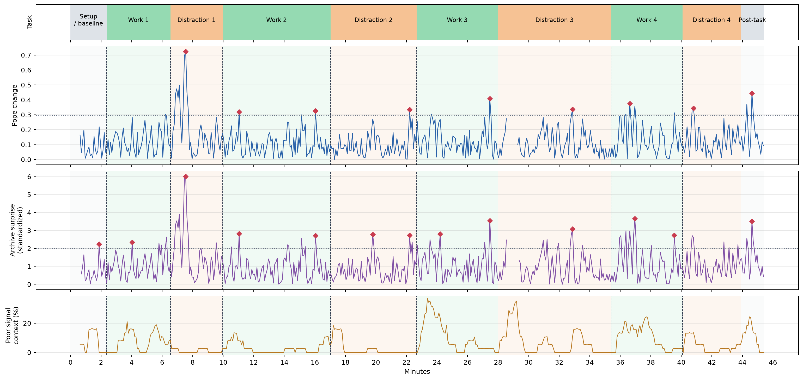

[Device reference](DEVICE.md) contains details about the device itself.

The data is limited to band summaries roughly once a second from one EEG channel. Blinking, muscle movement, and changes in sensor contact can also make the readings noisy.

I use two change scores:

1. A change score based on a beta/(alpha + theta) ratio [1]. The Greek letters refer to brain waves.

2. An archive-conditioned score that looks at whether that change is unusual given the other bands, recent signal quality and the earlier ratio level.

My working assumption is that the major shift in my signals will come from switching between studying (math in this case) and watching a show.

I make note of when I switch tasks, and that shows up on the figure. The times for when I switched are not used as a training signal. The idea is to see if the analysis on EEG data can pick up shifts in my state of mind roughly around when I switched.
More interestingly, as an alternative avenue, I explored whether conditioning on general brain activity, around nine hours in this case, would improve the "shift detector".

What each script does, in a nutshell:

- `data.py`: loads and processes the EEG data
- `archive_model.py`: given previous recordings, how unexpected is the current change in the ratio?
- `distraction_timeline.py`: plots the two scores, with the task switches and signal quality
## Reference

[1] Pope et al. (1995): https://doi.org/10.1016/0301-0511(95)05116-3

